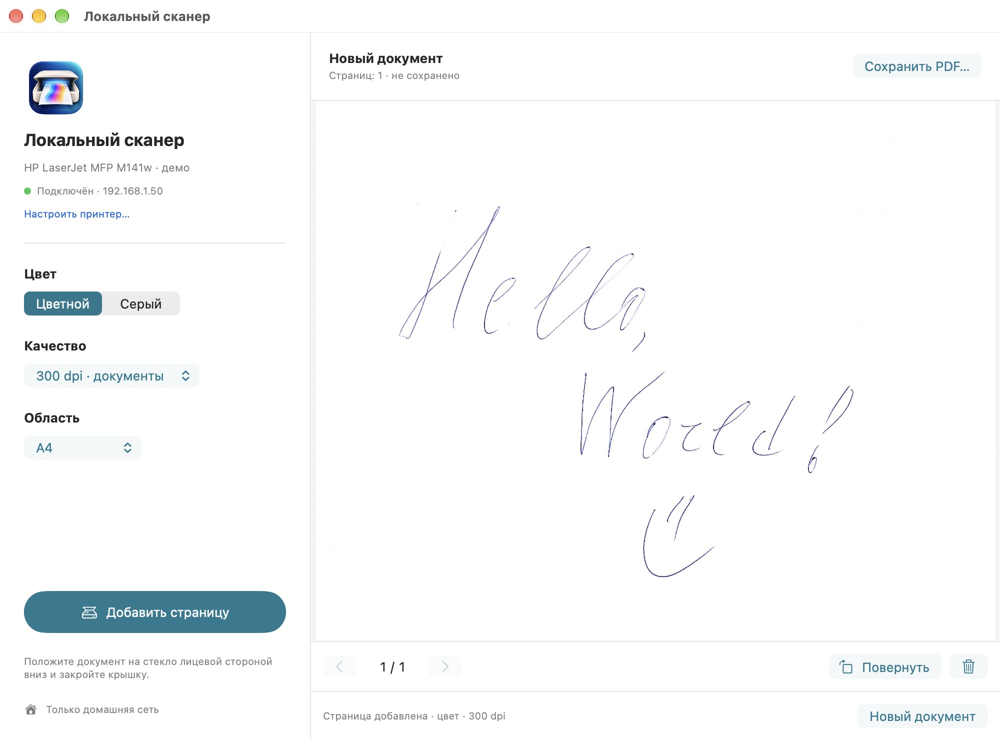
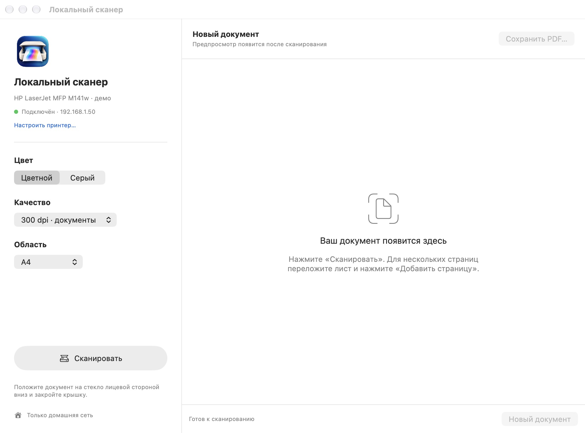

<p align="center"></p>

# Local Scan · Локальный сканер

A small native macOS app for scanning documents directly from a local eSCL scanner. Color scanning, PDF preview and multipage PDFs — without HP Smart, an HP account or a cloud service.

The interface is currently in Russian. Built with SwiftUI, AppKit and PDFKit, with no third-party runtime dependencies.

## Screenshots

**A real handwritten sample, scanned in color at 300 dpi on an HP LaserJet MFP M141w.**



**Ready to scan:** color, quality and scan area in one window.



Screenshots use the native app window with an actual scanned sample. Connection details are illustrative demo values; no personal documents or real network settings are shown.

## Download and use

Download the installer for your Mac from [Releases](https://github.com/Marcus-Rise/local-scan/releases). Automated releases provide `Local-Scan-vX.Y.Z-macOS-arm64.dmg` (Apple Silicon) and `Local-Scan-vX.Y.Z-macOS-x86_64.dmg` (Intel). Open the DMG and drag `LocalScan.app` to Applications. The existing v1.0.0 release is Apple Silicon-only: unzip its archive and move `Local Scan.app` to Applications.

1. Open **Принтеры → Добавить** and click **Добавить** next to a discovered scanner, or use **Добавить по IP-адресу**. Saved printers have separate actions to select, edit their name/address and delete them.
2. Confirm pairing with your printer in your trusted home network. The app shows the SHA-256 certificate fingerprint and remembers it.
3. Put a document face down on the flatbed and click **Сканировать**.
4. For more pages, replace the sheet and click **Добавить страницу**. Click **Сохранить PDF…** to save.

The app remembers the address and scan settings. Color at 300 dpi and A4 are the defaults. You can select grayscale, 200/300/600 dpi, use the full glass, rotate or delete a selected page, and save multiple pages in one PDF. Unsaved changes trigger a save prompt before closing.

Allow Local Scan to access your local network when macOS asks. If discovery or connection is blocked, check **System Settings → Privacy & Security → Local Network → Local Scan**, then retry **Проверить связь** in the printer list.

## Compatibility

- **macOS 14 or newer.** The automated release workflow builds separate Apple Silicon (`arm64`) and Intel (`x86_64`) installers. Intel support is not physically tested. The existing v1.0.0 release is Apple Silicon-only.
- Physically tested with **HP LaserJet MFP M141w**: color at 300 dpi, A4, multipage assembly, rotation and saved PDF verification.
- Other devices are **unverified**. They must expose HTTPS eSCL at `/eSCL/`, support flatbed scanning, RGB24/Grayscale8 and PDF output. Scan areas and the offered resolutions currently follow the tested device; capabilities are not fully negotiated.
- Bonjour discovery lists HTTPS eSCL scanners advertising `_uscans._tcp` on port 443 with a private IPv4 address. Manual IPv4 setup remains available. There is no automatic IP migration, feeder support or iPhone/iPad version.
- Scanning needs network reachability to the printer. The app cannot repair Wi-Fi authentication or router isolation.

The downloadable build is ad-hoc signed, without Apple Developer ID or notarization. macOS may require approval to open it. You can also build the app from source.

## Privacy and connection trust

Documents are retrieved directly from the printer over HTTPS, held in memory, and saved to the path you choose. The app has no analytics, remote service, HP login or administrator-password storage. The source repository contains no scanned documents or preconfigured printer identity.

Initial pairing uses **trust on first use**: the app cannot independently authenticate an unknown printer. Pair only with a device you recognize on a trusted local network; compare the certificate fingerprint with the device's certificate information where available. Once paired, only that certificate is accepted for the saved address. A changed certificate is blocked. Re-pair through **Принтеры → Изменить → Сбросить привязку** only after checking the device.

Public, loopback and non-IPv4 addresses are rejected. Redirects are rejected, and job URLs must stay on the paired device. Address, certificate fingerprint and scan preferences are stored in macOS UserDefaults. If the printer's IP changes, enter its new address and pair again.

## Build

Install Xcode Command Line Tools, then:

```sh
./build.sh
```

The ad-hoc signed app is written to `dist/Local Scan.app`. An optional first argument selects another output path. The default target is `arm64-apple-macosx14.0`; use `TARGET_ARCH=x86_64 ./build.sh` for Intel. Tests support the same `TARGET_ARCH` environment variable.

## Automated macOS builds and releases

The GitHub Actions workflow runs the existing `test.sh` and `build.sh` on macOS runners for both `arm64` and `x86_64`. It uses existing third-party actions to create DMG installers, upload build artifacts and publish GitHub Releases with SHA-256 checksums. No new packaging scripts or Apple Developer account are needed.

- **Pull requests and manual runs:** build, test, verify the ad-hoc signature and upload both DMGs as workflow artifacts. They do not publish a release.
- **Pushing a `vX.Y.Z` tag:** build and test both architectures first; only then publish a GitHub Release with both DMGs plus `checksums.sha256` and `checksums.json`.
- Keep the app version in `build.sh` (`CFBundleShortVersionString`) aligned with the release tag before tagging. The CI does not rewrite app metadata.

The `.app` bundles are **ad-hoc signed, not Developer ID signed or notarized**. Gatekeeper can still require a one-time manual approval on first launch. The workflow does not bypass macOS protections.

## Tests

On an Apple Silicon Mac:

```sh
./test.sh
# Optionally validate a real PDF from your scanner:
./test.sh /path/to/scan.pdf
```

Tests cover color defaults, eSCL XML namespaces and physical scan area, accepted settings, private addresses, certificate matching, job URL confinement and PDF validation. Printer-library tests cover migration, add/edit/delete, duplicate rejection, persistence, selection and certificate isolation when an address changes. One intentionally invalid PDF can produce a CoreGraphics diagnostic.

An opt-in live probe **runs a physical scan** and writes the result locally:

```sh
xcrun swiftc -target arm64-apple-macosx14.0 -module-cache-path .build-cache \
  Sources/ScannerCore.swift Tests/LiveProbe.swift -o .build-cache/live-probe
.build-cache/live-probe PRIVATE_IP SHA256_CERTIFICATE_PIN /path/to/result.pdf
```

Do not commit personal scans or local pairing data. Contributions and compatibility reports are welcome. Please include the device model and firmware, but remove document contents, credentials and personal network details from reports.

## License

[MIT](LICENSE). App icon created with an image generation tool. This project is independent and is not affiliated with HP or Apple.
